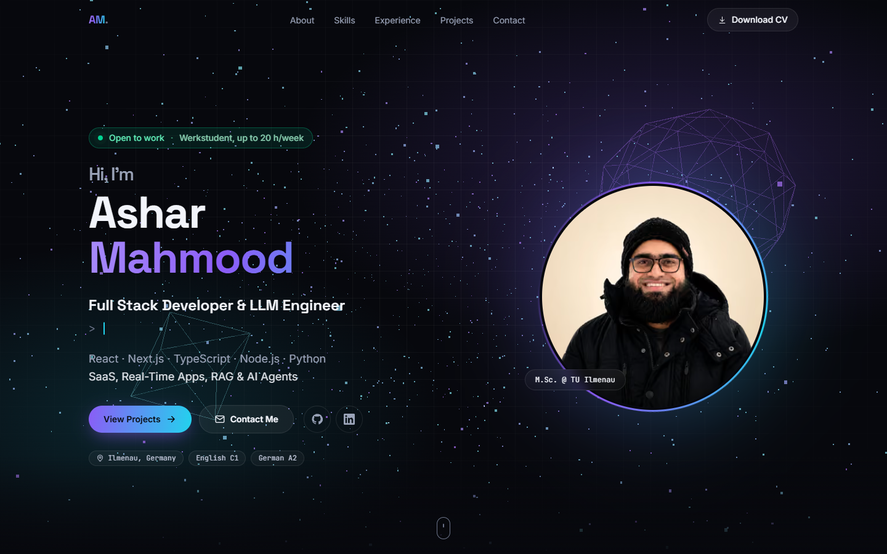
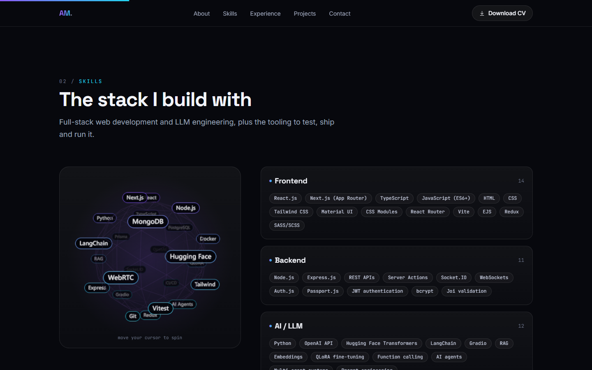
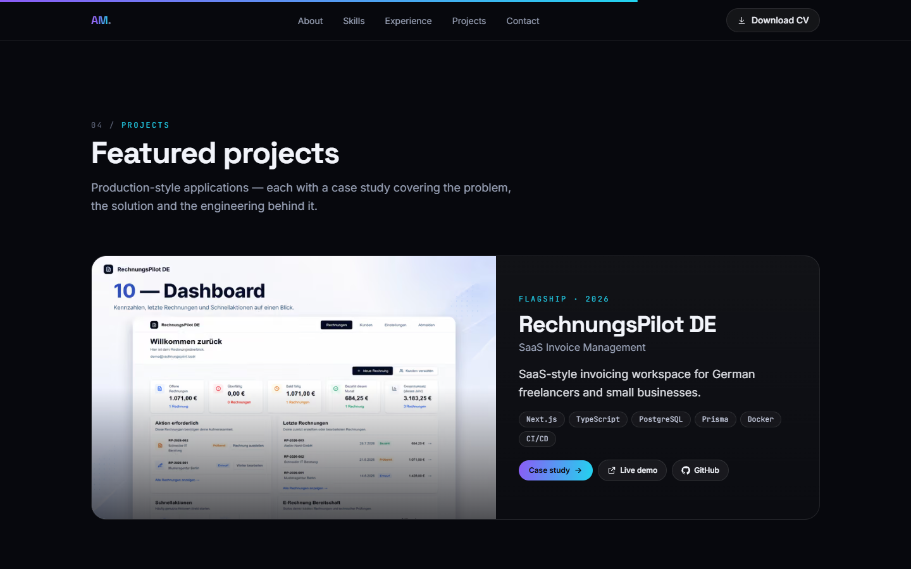
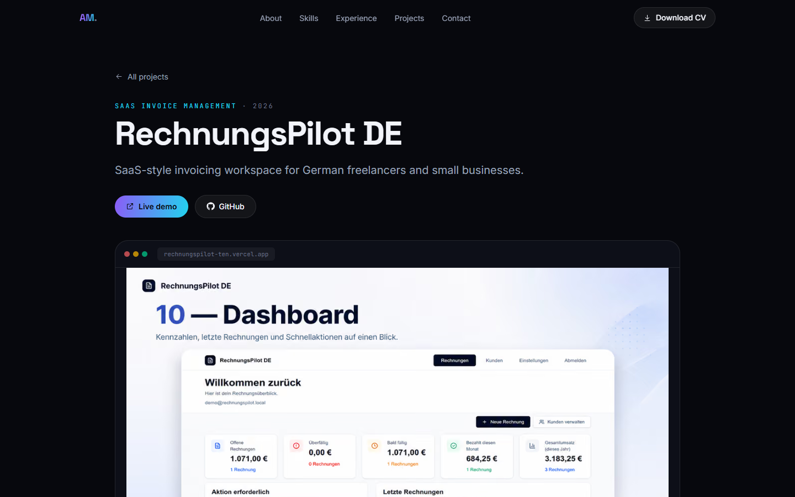
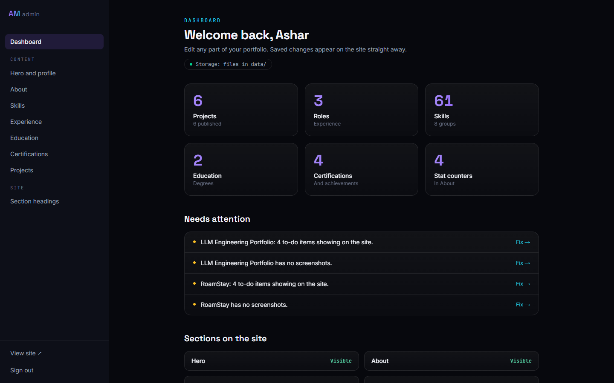
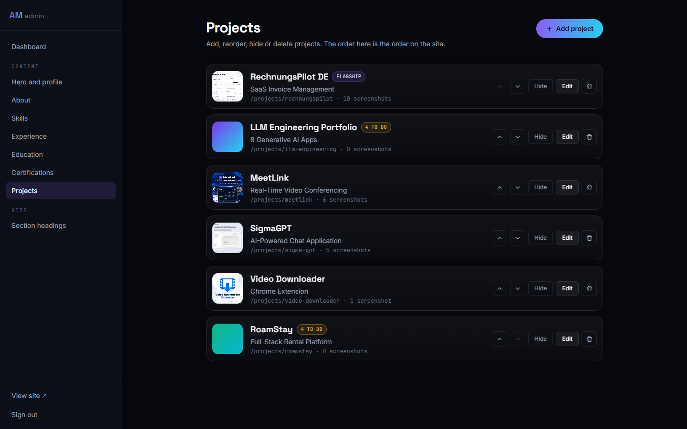
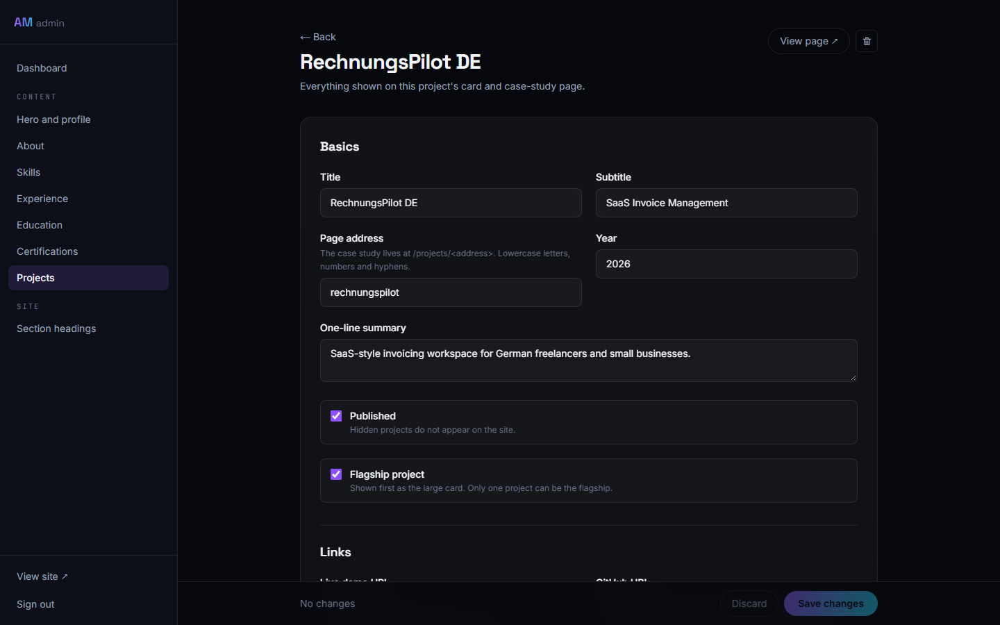

# Ashar Mahmood — Portfolio

The portfolio of a Full Stack Developer and LLM Engineer, built as a real product rather than a static page: an animated public site, plus a custom admin dashboard that controls every section of it. No template, no page builder and no third-party CMS.

**Live site:** [ashardev.com](https://ashardev.com)

**Built with** Next.js 15 (App Router) · React 19 · TypeScript · Tailwind CSS 4 · Framer Motion · Three.js · MySQL · Zod



## Highlights

- **Every word and image on the site is editable from a dashboard I built myself.** Projects, experience, skills, education, certifications, headings and the hero are all managed at `/admin`, with no code changes or redeploys.
- **One storage layer, two back ends.** The same code stores content in MySQL in production and in plain JSON files during development, and picks between them automatically.
- **The site stays up when the database does not.** If MySQL is unreachable, visitors keep seeing the last loaded content and the admin refuses to save rather than risk losing data.
- **3D where it adds something, and only there.** Three.js runs in two places and is switched off on small screens, low-powered devices and for visitors who prefer reduced motion.
- **Authentication, validation and upload checks are written from scratch**, without an auth library.

## The public site

| Area | What it does |
|---|---|
| Hero | Portrait, rotating role titles, availability badge, and a Three.js scene of particles and wireframe shapes behind it |
| About | Bio, animated stat counters, languages and current learning |
| Skills | Grouped skills, plus an interactive 3D cloud of skill labels |
| Experience | A timeline of roles with highlights, tech stack and key metrics |
| Projects | Cards that tilt towards the cursor, with one project featured as the flagship. The home page shows a set number, and a "View all projects" button leads to a page listing every project |
| Case studies | A page per project: problem, solution, engineering notes, features, stack, and a screenshot gallery with a full-screen lightbox |
| Contact | A form that emails the message straight to my inbox, with the visitor set as the reply-to address |

Supporting details:

- Smooth scrolling (Lenis), scroll-triggered reveals, magnetic buttons and a scroll progress bar.
- All motion respects the `prefers-reduced-motion` setting.
- SEO: per-page metadata, a generated social preview image, `sitemap.xml`, `robots.txt` and structured data (JSON-LD) for the person profile.
- Responsive from phone to desktop.

| Skills with the 3D cloud | Featured project |
|---|---|
|  |  |



## The admin dashboard

A password-protected control panel at `/admin`.



| Page | What can be managed |
|---|---|
| Dashboard | Content counts, the active storage mode, and a "needs attention" list (missing photo or CV, hidden projects, projects without screenshots) |
| Hero and profile | Name, role, rotating roles, portrait, availability badge, email, links and CV |
| About | Bio paragraphs, stat counters, learning list and languages |
| Skills | Skill groups and the labels in the 3D cloud |
| Experience | Roles, bullet points, tech stack and metrics |
| Education and certifications | Entries for each |
| Projects | Create, edit, delete, reorder, publish or hide, choose the flagship, write the full case study and upload screenshots |
| Section headings | Show or hide whole sections, edit their headings, and set how many projects the home page shows |

How it is built:

- **Schema-driven forms.** Each editor is described once as a list of field definitions (text, tags, lists, nested groups, image uploads, screenshot sets and more), and one renderer turns that into the form. Adding a field to the site means adding one line.
- **Add, edit, delete and reorder** on every list, with a confirmation step before deleting.
- **Unsaved-changes protection.** The editor tracks changes, saves with `Ctrl+S`, and warns before leaving a page with unsaved work.
- **Instant publishing.** A save is validated, written, and visible on the public site straight away.
- **Image and PDF uploads** from inside the forms, including multi-screenshot galleries with captions.

| Managing projects | Editing a project |
|---|---|
|  |  |

## Architecture

```
Browser ── public pages ─────────────┐
                                     ├─ content layer ─┬─ MySQL (production)
Browser ── /admin ── server actions ─┘   (Zod schema)  └─ JSON files (development)
```

- **A single schema is the source of truth.** One Zod schema defines the content model. It generates the TypeScript types, validates every save on the server, and validates whatever is read back from storage.
- **Server actions with one gate.** Every change goes through a single function that checks the session, loads the latest content, validates the result and writes it. There is no path that skips those steps.
- **Storage adapter.** `content.ts` and `uploads.ts` hide whether data lives in MySQL or on disk. In database mode the tables are created automatically and seeded from the bundled content on first run.
- **Graceful degradation.** Public pages reuse loaded content for a short time, so a database outage does not take the site down or add a failed connection attempt to every page view.
- **Uploads in the database.** Uploaded files are stored as rows and served through a route with long-lived cache headers, so they survive redeploys on hosts without persistent disks.

## Security

- Session cookie signed with HMAC, http-only, with a 7-day expiry.
- Password comparison in constant time.
- Login limited to 5 attempts per 15 minutes per IP address.
- Every save re-checks the session and validates the full content against the schema.
- Uploads require a signed-in session and a same-origin request, are limited to 8 MB, and have their type checked from the file's actual bytes rather than its name.
- Upload paths are restricted to a fixed pattern, which rules out path traversal.
- Database queries are parameterised, and all secrets live in environment variables.
- The admin is excluded from search engines.
- The contact form validates on the server, strips line breaks from header fields, limits each visitor to 3 messages per 10 minutes, and uses a hidden honeypot field to drop bot submissions.

## Tech stack

| Layer | Tools |
|---|---|
| Framework | Next.js 15 (App Router, server components, server actions), React 19 |
| Language | TypeScript |
| Styling | Tailwind CSS 4 |
| Animation | Framer Motion, Lenis |
| 3D | Three.js with @react-three/fiber |
| Data | MySQL (mysql2), Zod |
| Email | Nodemailer over SMTP |
| Hosting | Hostinger Node.js web app |

## Run it locally

Requires Node.js 20 or newer.

```bash
npm install
```

Copy `.env.example` to `.env.local` and set:

- `ADMIN_PASSWORD` — at least 8 characters
- `ADMIN_SESSION_SECRET` — at least 32 random characters

```bash
npm run dev
```

The site runs at http://localhost:3000 and the dashboard at http://localhost:3000/admin. With no database settings it stores content in `data/content.json` and uploads in `data/uploads/`.

For a production build: `npm run build`, then `npm run start`.

## Deployment

The site runs on any Node.js host. To use MySQL, set these environment variables alongside the two above:

| Variable | Value |
|---|---|
| `DB_HOST` | Database host |
| `DB_PORT` | Usually `3306` |
| `DB_USER` | Database user |
| `DB_PASSWORD` | Database password |
| `DB_NAME` | Database name |
| `NEXT_PUBLIC_SITE_URL` | The public address of the site, read at build time |

For the contact form to send email, also set:

| Variable | Value |
|---|---|
| `SMTP_HOST` | Mail server, such as `smtp.gmail.com` |
| `SMTP_PORT` | `465` |
| `SMTP_USER` | The mailbox that sends the messages |
| `SMTP_PASS` | That mailbox's password (for Gmail, an app password) |
| `CONTACT_TO` | Where messages are delivered; defaults to the email in the site profile |

Without the `SMTP_*` variables the form falls back to opening the visitor's email app.

On first start the tables are created and the content from `data/content.json` is copied in. From then on the database is the source of truth, and edits are made in the live dashboard.

On Hostinger: create a MySQL database in hPanel, add a Node.js web app from this repository (application type `next`, build script `build`, output directory `.next`), and add the variables before the first deploy. Hostinger's guides: [Next.js](https://docs.hostinger.com/node.js/overview-1/next), [build settings](https://docs.hostinger.com/node.js/build-settings).

Without the `DB_*` variables the site runs in file mode, which needs a host with a writable, persistent disk.

## Project structure

| Path | Contains |
|---|---|
| `src/app/(site)` | Public pages |
| `src/app/admin` | Dashboard pages, server actions and the upload endpoint |
| `src/app/media` | Route that serves uploaded files |
| `src/components` | Public site components (`HeroScene.tsx` and `SkillsCloud.tsx` are the Three.js scenes) |
| `src/components/admin` | Form renderer (`fields.tsx`) and editor definitions (`schemas.ts`) |
| `src/lib` | Content schema, storage (`content.ts`, `uploads.ts`, `db.ts`) and authentication |
| `data` | Starting content, and uploads in file mode |
| `docs/screenshots` | Images used in this README |

## Contact

- GitHub: [ashardeveloper](https://github.com/ashardeveloper)
- LinkedIn: [asharmahmood-](https://www.linkedin.com/in/asharmahmood-/)
